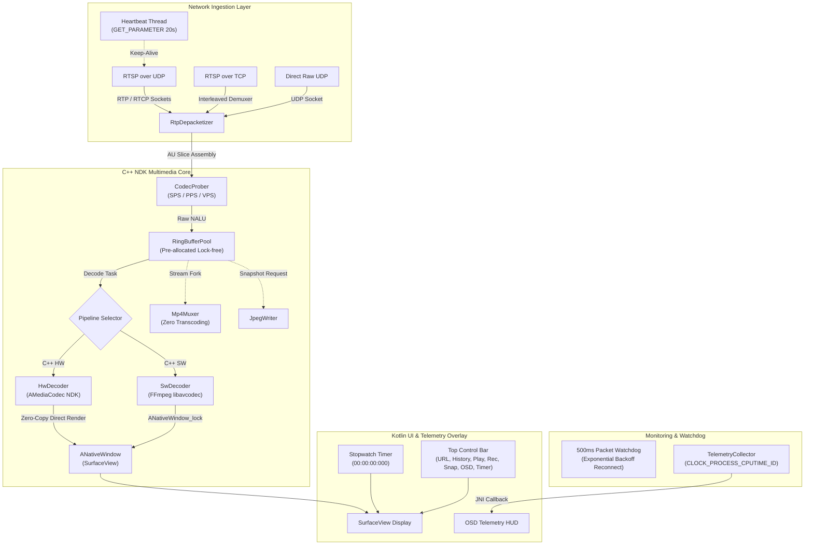

# Lazy RTSP Player (Android)

> **[繁體中文說明文件 (Traditional Chinese Document)](./README_CH.md)**

A high-performance, ultra-low latency RTSP and Direct UDP video player designed as an **Android reference implementation** and **benchmarking testbed** for FPV drones, robotics, IPCams, and Glass-to-Glass (G2G) latency evaluation.

---

## 🚀 Key Features

- **Zero-Copy Hardware Decoding Pipeline**:
  - Implemented entirely in C++ NDK using native BSD sockets, custom RTP depacketizer, and `AMediaCodec`.
  - Zero JVM memory copies: Decoded video frames are rendered directly to `ANativeWindow` (SurfaceView) via hardware overlays.
- **Dual Pipeline & Fallback Support**:
  - Primary: NDK C++ + `AMediaCodec` Hardware Zero-Copy.
  - Fallback: NDK C++ + FFmpeg `libavcodec` CPU Software Decoder with signal guard.
- **Multi-Transport Compatibility**:
  - **RTSP over UDP (Unicast)**: Ultra-low latency transmission for local networks.
  - **RTSP over TCP (Interleaved)**: Stable traversal through restrictive firewalls.
  - **Direct UDP (Raw Stream)**: Direct NALU packet reception without RTSP handshake overhead (e.g., FPV drone streaming on port 5600).
- **RTSP Keep-Alive & Robust Auto-Reconnection**:
  - Active keep-alive heartbeat loop sending `GET_PARAMETER` periodically to prevent 55-second RTSP session timeouts.
  - Randomized client RTP/RTCP port pair allocation with timestamp seeding to eliminate port collisions on immediate reconnects.
  - 500ms packet watchdog: Freezes last frame upon packet loss and retries reconnection using exponential backoff (`200ms -> 500ms -> 1s -> 2s`).
  - Purges non-reference frames during reconnection, strictly resuming display only on the next IDR keyframe to prevent macroblocking.
- **Access Unit (AU) Assembly for Multi-Slice Streams**:
  - Aggregates multi-slice NALUs into complete Access Units before feeding into `AMediaCodec`, completely eliminating solid green screens or tearing on multi-slice encoders.
- **Glass-to-Glass (G2G) Millisecond Stopwatch**:
  - Built-in high-contrast digital stopwatch HUD (`00:00:00:000`) with millisecond precision.
  - Monospaced typography and anti-jitter layout, specifically tailored for optical G2G latency measurement via high-speed cameras.
  - Dedicated `TIMER` toggle button on the top control bar with active state color indicators.
- **Real-Time OSD Telemetry HUD**:
  - Non-intrusive on-screen display tracking:
    - Pipeline mode, Transport protocol, and Codec resolution.
    - Real-time Bitrate (kbps) and Render FPS vs. Source FPS.
    - Hardware decode latency (ms).
    - Dropped frame metrics (Jitter drops / Network packet loss).
    - High-precision Process CPU utilization (via POSIX `CLOCK_PROCESS_CPUTIME_ID`, fully compatible with Android 14 SELinux restrictions).
    - Memory usage (RSS & PSS in MB) and GPU frequency state.
  - Dedicated `OSD` toggle button and double-tap / remote MENU shortcut.
- **Untainted Media Capture (Zero-Transcoding)**:
  - **Clean MP4 Recording**: Direct NALU stream remuxing via `AMediaMuxer` without re-encoding, completely free of OSD overlays.
  - **Clean JPEG Snapshot**: Pure uncompressed video frame capture to JPEG.
- **Android TV & D-Pad Optimization**:
  - Full support for TV remote D-pad navigation, DPAD_CENTER / ENTER controls, and double-press BACK protection.
  - SharedPreferences-backed LRU history queue storing the last 5 active stream URLs with cold-start auto-restore.

---

## 📐 System Architecture



---

## 📊 Benchmark & Performance

Tested on a physical **Xiaomi Smart TV** (`MiTV-AFMU0`, Android 14, 4-core SoC) with local RTSP test stream (1280x720 @ 30fps H.264, ~5.2 Mbps):

| Metric | Target Specification | Actual Test Result | Status |
| :--- | :--- | :--- | :--- |
| **Decode Latency** | $\le 20 \text{ ms}$ | **$16.5 \sim 18.4 \text{ ms}$** | PASS |
| **Render FPS** | 30.0 fps (no frame tearing) | **$29.8 \sim 30.6 \text{ fps}$** | PASS |
| **CPU Utilization** | $\le 15\%$ total system | **$8.7\% \sim 11.5\%$ (App CPU)** | PASS |
| **JVM Memory Copy** | 0 times (Zero-Copy) | **0 times (`ANativeWindow`)** | PASS |
| **Continuous Playback**| $> 60 \text{ s}$ without freeze | **Sustained $> 10 \text{ min}$** | PASS |
| **Release APK Size** | $\le 15 \text{ MB}$ | **$5.1 \text{ MB}$** | PASS |
| **APK Signature** | Scheme v2 Signed | **Verified (v2 = True)** | PASS |

---

## 🛠️ Build & Installation

### Option 1: Docker Hermetic Build (Recommended)

A pre-configured Docker image containing Android SDK 34, NDK 26b, CMake 3.22, and Build Tools 35 ensures a 100% reproducible build across any host environment:

```bash
# Build the Docker builder image (one-time setup)
docker build -t rtsp-player-builder:v1.0 .

# Compile both signed Debug and Release APKs
docker run --rm \
    -v $(pwd):/workspace \
    -v ~/.gradle:/root/.gradle \
    -w /workspace \
    rtsp-player-builder:v1.0 \
    ./gradlew assembleDebug assembleRelease
```

### Option 2: Local Android Studio / Gradle

Requires JDK 17+, Android SDK API 34, and NDK installed:

```bash
./gradlew assembleDebug assembleRelease
```

### Output APK Locations

- **Release APK**: `app/build/outputs/apk/release/Lazy_RTSP_Player_1.4.0.apk` (Size: ~5.1 MB, Signed)
- **Debug APK**: `app/build/outputs/apk/debug/Lazy_RTSP_Player_1.4.0_debug.apk` (Size: ~9.2 MB, Signed)

### Deploy to Test Device

```bash
adb install -r app/build/outputs/apk/release/Lazy_RTSP_Player_1.4.0.apk
adb shell am start -n com.kenny.lazyplayer/com.kenny.lazyplayer.MainActivity
```

---

## 🎮 Controls & Shortcuts

| Action | Touch / Mouse | Android TV Remote (D-Pad) |
| :--- | :--- | :--- |
| **Connect / Stop** | Tap `PLAY` / `STOP` | D-pad navigation + `DPAD_CENTER` |
| **Toggle OSD Telemetry** | Tap `OSD` button or Double-tap screen | TV `MENU` button or D-pad to `OSD` |
| **Toggle Stopwatch Timer**| Tap `TIMER` button | D-pad to `TIMER` + `DPAD_CENTER` |
| **Record Clean MP4** | Tap `RECORD` / `STOP REC` | D-pad to `RECORD` + `DPAD_CENTER` |
| **Take Clean Snapshot** | Tap `SNAPSHOT` | D-pad to `SNAPSHOT` + `DPAD_CENTER` |
| **Settings Dialog** | Tap `SETTINGS` or Long-press screen (1.5s) | D-pad to `SETTINGS` + `DPAD_CENTER` |
| **Exit Application** | Android Back Button | Press `BACK` twice within 2 seconds |

---

## 📄 License

This project is licensed under the **[MIT License](./LICENSE)**.

```
MIT License
Copyright (c) 2026 Kenny (Labujuice)
```

You are free to use, copy, modify, merge, publish, distribute, sublicense, and/or sell copies of the Software without restriction, provided that the copyright notice and this permission notice are included in all copies or substantial portions of the Software. See the [LICENSE](./LICENSE) file for complete details.

