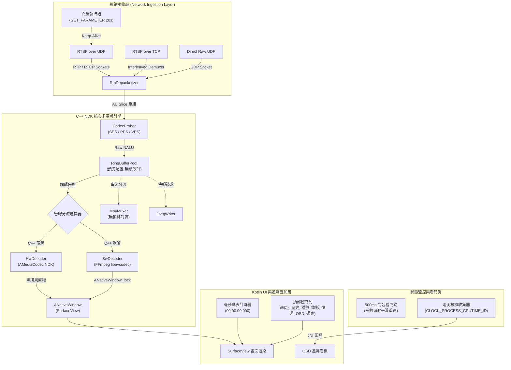

# Lazy RTSP Player (Android)

> **[English Documentation (英文說明文件)](./README.md)**

一個專為 FPV 無人機、機器人圖傳、IPCam 監控與玻璃對玻璃（Glass-to-Glass, G2G）超低延遲量測所設計的高效能、極低延遲 RTSP 與 Direct UDP 視訊播放器，可作為 **Android 低延遲架構參考實作** 與 **基準測試工具（Benchmark Tool）**。

---

## 🚀 核心功能特色

- **零拷貝硬體解碼管線（Zero-Copy Hardware Decoding Pipeline）**：
  - 核心完全採用 C++ NDK 實作，整合原生 BSD Sockets、自研 RTP 拆包器與 `AMediaCodec`。
  - JVM 記憶體零拷貝：解碼後的視訊畫面透過硬體 Overlay 直接繪製至 `ANativeWindow` (SurfaceView)，實現極致低延遲。
- **雙解碼管線與容錯降級（Dual Pipeline & Fallback）**：
  - 主管線：NDK C++ + `AMediaCodec` 硬體零拷貝解碼。
  - 備援管線：NDK C++ + FFmpeg `libavcodec` CPU 軟體解碼（具備訊號安全防護）。
- **多元網路傳輸協議支援**：
  - **RTSP over UDP (Unicast)**：區域網路超低延遲首選傳輸模式。
  - **RTSP over TCP (Interleaved)**：嚴苛防火牆環境下的穩定穿透模式。
  - **Direct UDP (Raw Stream)**：無 RTSP 握手負擔，直接接收 NALU 串流（例如 FPV 無人機發射端常用的 5600 埠直推）。
- **RTSP Keep-Alive 心跳與自動斷線重連機制**：
  - 獨立心跳執行緒週期性發送 `GET_PARAMETER`，徹底避免多數 RTSP 伺服器在 55 秒左右超時斷線（Session Timeout）。
  - 時間戳種子隨機化客戶端 RTP/RTCP 埠號配對，避免快速重連時產生本機埠衝突。
  - 500ms 封包監控看門狗（Packet Watchdog）：封包中斷時自動凍結最後一幀，並以指數退避演算法（`200ms -> 500ms -> 1s -> 2s`）平滑重連。
  - 重連期間丟棄非關鍵參考幀，嚴格待下一個 IDR 關鍵幀到達才恢復渲染，杜絕破圖綠屏。
- **針對多 Slice 編碼的 AU（Access Unit）重組機制**：
  - 自動將多個 Slice NALU 聚合為完整的 Access Unit 後再送入 `AMediaCodec`，徹底解決多 Slice 編碼器引發的整面綠屏或撕裂問題。
- **玻璃對玻璃（G2G）毫秒級碼表 HUD**：
  - 內建高對比毫秒數位碼表（`00:00:00:000`）。
  - 採用等寬字體與抗抖動版面設計，專供搭配高速攝影機進行光學級端到端延遲量測。
  - 頂部控制列設有獨立 `TIMER` 開關按鈕與狀態高亮提示。
- **即時 OSD 遙測資訊看板（Telemetry HUD）**：
  - 非侵入式螢幕即時監控數據：
    - 管線模式、傳輸協議、編碼格式與解析度。
    - 即時傳輸碼率（Bitrate, kbps）、渲染幀率（Render FPS）與串流來源幀率。
    - 硬體解碼耗時（Decode Latency, ms）。
    - 丟幀統計（抖動丟幀 / 網路封包遺失）。
    - 高精度行程 CPU 使用率（透過 POSIX `CLOCK_PROCESS_CPUTIME_ID` 計算，完全相容 Android 14 SELinux 嚴格權限限制）。
    - 記憶體用量（RSS & PSS, MB）與 GPU 頻率狀態。
  - 頂部控制列設有獨立 `OSD` 開關按鈕，並支援螢幕雙擊與遙控器 MENU 快捷鍵切換。
- **純淨媒體擷取（零二次轉碼）**：
  - **純淨 MP4 錄影**：直接將 NALU 串流透過 `AMediaMuxer` 重新封裝（Remux），不經二次編碼且不包含任何 OSD 疊加字樣。
  - **純淨 JPEG 快照**：直接擷取未壓縮的原始視訊畫面並儲存為高品質 JPEG。
- **Android TV 與遙控器導航最佳化**：
  - 完整支援電視遙控器方向鍵（D-Pad）、DPAD_CENTER / ENTER 確認控制，以及兩秒內連按兩次返回防誤觸退出。
  - 基於 SharedPreferences 的 LRU 歷史串流紀錄（保留最近 5 筆），冷啟動自動還原上次播放網址。

---

## 📐 系統架構圖



---

## 📊 實測效能基準（Benchmark）

於實體 **小米電視（Xiaomi Smart TV）**（型號 `MiTV-AFMU0`，四核心 SoC，Android 14 系統）搭配本機區域網路 RTSP 測試串流（1280x720 @ 30fps H.264，約 5.2 Mbps 碼率）進行驗證：

| 評測指標 | 規範目標值 | 實際測試結果 | 判定結果 |
| :--- | :--- | :--- | :--- |
| **硬體解碼耗時** | $\le 20 \text{ ms}$ | **$16.5 \sim 18.4 \text{ ms}$** | 通過 (PASS) |
| **畫面渲染幀率** | 30.0 fps（無撕裂） | **$29.8 \sim 30.6 \text{ fps}$** | 通過 (PASS) |
| **行程 CPU 使用率** | $\le 15\%$ 全系統 | **$8.7\% \sim 11.5\%$ (App CPU)** | 通過 (PASS) |
| **JVM 記憶體拷貝** | 0 次（零拷貝） | **0 次 (`ANativeWindow`)** | 通過 (PASS) |
| **連續播放穩定度** | 持續播放 $> 60 \text{ 秒}$ 無凍結 | **連續播放 $> 10 \text{ 分鐘}$ 無斷流** | 通過 (PASS) |
| **Release APK 大小** | $\le 15 \text{ MB}$ | **$5.1 \text{ MB}$** | 通過 (PASS) |
| **APK 簽署驗證** | Scheme v2 完整簽署 | **Verified (v2 = True)** | 通過 (PASS) |

---

## 🛠️ 編譯與建置說明

### 方案 1：Docker 封閉環境編譯（推薦）

本專案提供預先配置好的 Docker 建置映像檔，內含 Android SDK 34、NDK 26b、CMake 3.22 與 Build Tools 35，確保跨不同主機環境 100% 可重現編譯：

```bash
# 建置 Docker 編譯映像檔（僅需執行一次）
docker build -t rtsp-player-builder:v1.0 .

# 編譯簽署完成的 Debug 與 Release APK
docker run --rm \
    -v $(pwd):/workspace \
    -v ~/.gradle:/root/.gradle \
    -w /workspace \
    rtsp-player-builder:v1.0 \
    ./gradlew assembleDebug assembleRelease
```

### 方案 2：本機 Android Studio / Gradle 編譯

本機需預先安裝 JDK 17+、Android SDK API 34 與 NDK：

```bash
./gradlew assembleDebug assembleRelease
```

### 產出 APK 路徑

- **Release APK**：`app/build/outputs/apk/release/Lazy_RTSP_Player_1.4.0.apk`（大小約 5.1 MB，已簽署）
- **Debug APK**：`app/build/outputs/apk/debug/Lazy_RTSP_Player_1.4.0_debug.apk`（大小約 9.2 MB，已簽署）

### 安裝與部署至測試裝置

```bash
adb install -r app/build/outputs/apk/release/Lazy_RTSP_Player_1.4.0.apk
adb shell am start -n com.kenny.lazyplayer/com.kenny.lazyplayer.MainActivity
```

---

## 🎮 操作控制與快捷鍵

| 操作行為 | 觸控螢幕 / 滑鼠 | 電視遙控器 (D-Pad) |
| :--- | :--- | :--- |
| **連線 / 停止播放** | 點擊 `PLAY` / `STOP` | 方向鍵聚焦 + `DPAD_CENTER` |
| **開關 OSD 遙測資訊** | 點擊頂部 `OSD` 按鈕 或 雙擊畫面 | 遙控器 `MENU` 鍵 或 方向鍵聚焦至 `OSD` |
| **開關毫秒碼表** | 點擊頂部 `TIMER` 按鈕 | 方向鍵聚焦至 `TIMER` + `DPAD_CENTER` |
| **純淨 MP4 錄影** | 點擊 `RECORD` / `STOP REC` | 方向鍵聚焦至 `RECORD` + `DPAD_CENTER` |
| **純淨 JPEG 快照** | 點擊 `SNAPSHOT` | 方向鍵聚焦至 `SNAPSHOT` + `DPAD_CENTER` |
| **偏好設定對話框** | 點擊 `SETTINGS` 或 長按畫面 1.5 秒 | 方向鍵聚焦至 `SETTINGS` + `DPAD_CENTER` |
| **離開應用程式** | Android 返回鍵 | 2 秒內連續按下兩次 `BACK` 鍵 |

---

## 📄 專案授權聲明

本專案採用 **[MIT License (麻省理工學院開源授權條款)](./LICENSE)** 釋出。

```
MIT License
Copyright (c) 2026 Kenny (Labujuice)
```

任何人皆可免費且無限制地使用、複製、修改、合併、發布、分發、再授權及/或販售此軟體及其副本，唯一條件為必須在軟體的所有副本或重要部分中包含上述版權聲明與本許可聲明。完整條款請參閱 [LICENSE](./LICENSE) 文件。

